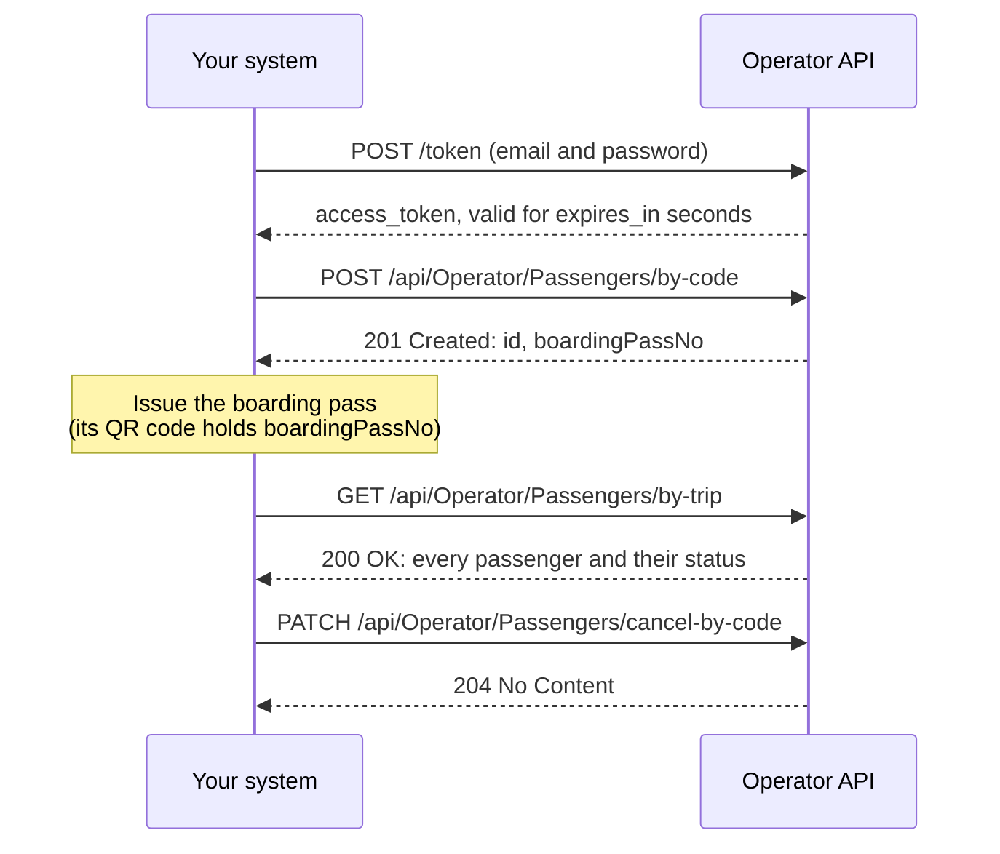

The **Operator API** lets a ferry operator's own system — a booking engine, a
ticketing website, a sales counter app — check passengers in to the operator's
trips without anyone retyping them in the [Operator Portal](/ferry-operator/).
These pages are for the developers building that connection.

| What you want to do | Endpoint | Permission | Guide |
| --- | --- | --- | --- |
| Check a passenger in and get their boarding pass number | `POST /api/Operator/Passengers/by-code` | `operator.passenger.write` | [Check In a Passenger](/ferry-operator-api/check-in-passenger) |
| Cancel a check-in | `PATCH /api/Operator/Passengers/cancel-by-code` | `operator.passenger.cancel` | [Cancel a Check-in](/ferry-operator-api/cancel-passenger) |
| List every passenger on a trip with their status | `GET /api/Operator/Passengers/by-trip` | `operator.passenger.read` | [Get Passenger Statuses](/ferry-operator-api/passenger-status-list) |

:::info[Server to server only]
Call the API from your **server**. Browsers are blocked — the API accepts browser
requests only from the Opusbay portals. Never put the integration account's
password in a web page or a mobile app.
:::

:::tip[Swagger]
The same endpoints, with their request and response schemas, are in Swagger at
`{API_BASE_URL}/swagger` — choose **Operator API v1** in the definition list at
the top right.
:::

## A typical flow



## What you need

| Item | What it is | Where it comes from |
| --- | --- | --- |
| **API base URL** | Written as `{API_BASE_URL}` on these pages. | The terminal team. |
| **Operator code** | Your operator's **Code**, for example `OP001` — **not** its Trip Code. Sent in the `X-Operator-Code` header. | The terminal team. |
| **Client id** | Always `opusbay-ts-web`. | — |
| **Integration account** | An email and password that can sign in, set up as below. | You, and your Operator Portal administrator. |
| **Route trip codes** | The short trip code of each of your routes, for example `HW`. | The terminal team — or read them off your trip codes, see [Identify the trip](#identify-the-trip). |

## Set up the integration account

Use a **dedicated account** for the integration, not a person's account. It signs
in like any other user, so it is set up the same way:

1. **Register** it with a mailbox your team controls, and confirm the email — see
   [Register an Account](/register-account).
2. Your Operator Portal administrator **adds it as a user** with exactly that
   email — see [Add a New User](/operator-administrator/add-user) — and a Super
   Admin **activates** it — see
   [Activate or Deactivate a User](/operator-administrator/activate-deactivate-user).
3. **Give it the three permissions** through a role — see
   [Add a New Role](/operator-administrator/add-role),
   [Manage a Role's Permissions](/operator-administrator/manage-role-permissions)
   and [Assign a Role to a User](/operator-administrator/assign-role):
   - `operator.passenger.write` — check in
   - `operator.passenger.cancel` — cancel a check-in
   - `operator.passenger.read` — list passenger statuses

:::warning[Don't make it an Admin]
An Admin passes **every** permission check, so a leaked password would expose far
more than passenger check-in. Grant only the three permissions above.
:::

## Get an access token

Sign in with the account's email and password. URL-encode both values in the
form body.

```http
POST {API_BASE_URL}/token
Content-Type: application/x-www-form-urlencoded

grant_type=password&client_id=opusbay-ts-web&username={email}&password={password}
```

```json
{ "access_token": "eyJhbGciOi…", "expires_in": 300, "token_type": "Bearer" }
```

Send the token on every call as `Authorization: Bearer {access_token}`. It
expires after `expires_in` seconds — currently 5 minutes, but always read the
value. Keep the token and reuse it until shortly before it expires, then sign in
again. Don't sign in before every call.

A wrong email or password returns `400` with
`{"error":"invalid_grant","error_description":"Incorrect email or password."}`.
[How Sign-In and Access Work](/how-sign-in-works) explains the tokens in plain
language.

:::note[Limits]
- `/token` accepts **10 requests per minute per public IP address**, shared by
  everything behind that address. Over the limit it returns `429`.
- **10 wrong passwords in a row** lock the account for **15 minutes**.
:::

<details>
<summary>Optional: renew with a refresh token instead of the password</summary>

Add `offline_access=true` to the sign-in form. The response body is the same,
and a **refresh token** arrives only in the `Set-Cookie: refresh_token=…`
response header. Renew with:

```http
POST {API_BASE_URL}/token
Content-Type: application/x-www-form-urlencoded

grant_type=refresh_token&refresh_token={value from the latest Set-Cookie}
```

- **Every renewal rotates it.** Store the new value from `Set-Cookie` and drop the
  old one. Sending an already-used refresh token ends the whole session.
- **Post it in the form body.** Don't keep a cookie jar or send a `Cookie` header
  to `/token`: a request carrying the cookie is treated as a browser and refused
  with `403`.
- **Keep the same `User-Agent`** for sign-in and every renewal. A renewal from a
  different OS or browser family ends the session.
- **When a renewal returns `400` with `"error":"invalid_grant"`, sign in again**
  with the password. A session also ends 30 days after sign-in, however active.

</details>

## Send these headers

| Header | Value |
| --- | --- |
| `Authorization` | `Bearer {access_token}` |
| `X-Operator-Code` | Your operator code, for example `OP001` |
| `Content-Type` | `application/json` — on `POST` and `PATCH` |

Every call acts for the operator in `X-Operator-Code`. The integration account
must be an active user of that operator, and it only ever sees and changes that
operator's trips and passengers.

## Identify the trip

You never send a trip id. Every call names the trip by the parts of its **trip
code** instead:

| Field | Format | Example | Notes |
| --- | --- | --- | --- |
| `tripType` | integer | `0` | `0` Scheduled (generated from a timeslot), `1` AdHoc (a one-off trip). |
| `routeTripCode` | string | `"HW"` | The route's trip code. |
| `tripDate` | `yyyy-MM-dd` | `"2026-11-02"` | The sailing date, in the departure port's local time. |
| `departure` | `HH:mm:ss`, 24-hour | `"09:30:00"` | The **scheduled** departure, in the departure port's local time. |
| `suffix` | string, optional | `null` | Only for a trip whose code ends with a suffix. Otherwise leave it out. |

The API builds the trip code from these parts, plus your operator's own trip
code, which it takes from `X-Operator-Code`:

| Part | Example | Comes from |
| --- | --- | --- |
| Type | `S` | `tripType`: `S` for Scheduled, `A` for AdHoc |
| Operator trip code | `SF` | Your operator — never sent |
| Route trip code | `HW` | `routeTripCode` |
| Date | `20261102` | `tripDate` |
| Time | `0930` | `departure`, hours and minutes |
| Suffix | — | `suffix`, when the trip has one |

Together: **`SSFHW202611020930`**. The same code is shown on every trip in the
Operator Portal — in the Departure Trips grid and on the trip's detail page, see
[Look Up a Trip](/ferry-operator/look-up-trip). Reading it backwards is the
quickest way to find a route's trip code or a trip's suffix. A suffix exists only
when two trips would otherwise share a code — same route, date and departure time.

:::warning[A delay does not change the code]
When the terminal records a delay, the trip keeps its **scheduled** departure in
its code. Always send the scheduled time, not the delayed one.
:::

:::tip[Debugging a 404]
When no trip matches, the error message names the code the API looked for — for
example `Departure trip not found (code 'SSFHW202611021000').` Compare it with the
code in the Operator Portal to see which part is wrong.
:::

## Data formats

- Request and response bodies are **JSON**, with **camelCase** field names.
- **Dates** are `yyyy-MM-dd` and **times** are 24-hour `HH:mm:ss`, with no time
  zone. A trip's date and departure are in the departure port's local time.
- **Enumerations are integers:**

  | Field | Values |
  | --- | --- |
  | `tripType` | `0` Scheduled, `1` AdHoc |
  | `gender` | `0` Male, `1` Female, `2` Unspecified |
  | `status` (passenger) | `0` CheckedIn, `1` PreImmigration, `2` Boarded, `3` Cancelled |

## Errors

Errors raised by the endpoints themselves share one envelope:

```json
{
  "exception": {
    "type": "UserFriendlyException",
    "message": "No available seats on this trip.",
    "errors": null,
    "traceId": "0HNG4A8V3KQ1E:00000003",
    "statusCode": 400,
    "stackTrace": null
  }
}
```

| HTTP | `type` | Meaning |
| --- | --- | --- |
| 400 | `ValidationException` | One or more fields are invalid. `errors` lists the messages per field, for example `{"No": ["A passenger with this No already exists on this trip."]}`. |
| 400 | `UserFriendlyException` | A business rule refused the request. Read `message`. |
| 404 | `NotFoundException` | The trip, passenger or country wasn't found. Read `message`. |
| 500 | varies | Something unexpected. `message` is `An unexpected error occurred.` |

Show `message` to your staff, and quote `traceId` when you report a problem.

Some requests are refused before they reach the endpoint, with a different body:

| HTTP | When | Body |
| --- | --- | --- |
| 400 | `X-Operator-Code` is missing or empty. Checked first, even before the token. | `{"error":"X-Operator-Code header is required"}` |
| 404 | `X-Operator-Code` isn't an active operator. | `{"error":"Operator not found"}` |
| 401 | The access token is missing, invalid or expired. | empty |
| 403 | The account isn't an active user of that operator. | `User not registered in this Operator.` |
| 403 | The account lacks the endpoint's permission. | empty |
| 400 | The body isn't valid JSON, a required field is missing, or a value has the wrong format. | A validation problem (`application/problem+json`) with `title`, `status` and `errors`. |

:::tip[What to do with an error]
- **401** — get a new token, then retry once.
- **400, 403 or 404** — don't retry unchanged; fix the request or the account.
- **500 or a timeout** — retrying is safe. Each guide explains what a retry
  returns if the first attempt had in fact succeeded.
:::

## Next

- [Check In a Passenger](/ferry-operator-api/check-in-passenger)
- [Cancel a Check-in](/ferry-operator-api/cancel-passenger)
- [Get Passenger Statuses](/ferry-operator-api/passenger-status-list)
