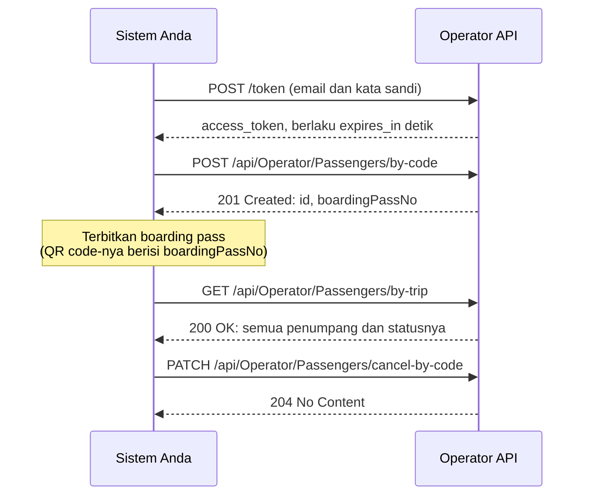

**Operator API** memungkinkan sistem milik operator feri — mesin pemesanan, situs
penjualan tiket, aplikasi konter penjualan — melakukan check-in penumpang ke
perjalanan operator tanpa perlu diketik ulang di [Operator Portal](/ferry-operator/).
Halaman-halaman ini ditujukan bagi developer yang membangun koneksi tersebut.

| Yang ingin Anda lakukan | Endpoint | Permission | Panduan |
| --- | --- | --- | --- |
| Check-in penumpang dan mendapatkan nomor boarding pass-nya | `POST /api/Operator/Passengers/by-code` | `operator.passenger.write` | [Check-in Penumpang](/ferry-operator-api/check-in-passenger) |
| Membatalkan check-in | `PATCH /api/Operator/Passengers/cancel-by-code` | `operator.passenger.cancel` | [Membatalkan Check-in](/ferry-operator-api/cancel-passenger) |
| Melihat semua penumpang di sebuah perjalanan beserta statusnya | `GET /api/Operator/Passengers/by-trip` | `operator.passenger.read` | [Melihat Status Penumpang](/ferry-operator-api/passenger-status-list) |

:::info[Hanya server ke server]
Panggil API dari **server** Anda. Browser diblokir — API hanya menerima permintaan
browser dari portal Opusbay. Jangan pernah menaruh kata sandi akun integrasi di
halaman web atau aplikasi seluler.
:::

:::tip[Swagger]
Endpoint yang sama, lengkap dengan skema permintaan dan responsnya, tersedia di
Swagger pada `{API_BASE_URL}/swagger` — pilih **Operator API v1** di daftar
definisi di kanan atas.
:::

## Alur yang Umum {/* #a-typical-flow */}



## Yang Anda Perlukan {/* #what-you-need */}

| Item | Penjelasan | Sumbernya |
| --- | --- | --- |
| **URL dasar API** | Ditulis sebagai `{API_BASE_URL}` di halaman-halaman ini. | Tim terminal. |
| **Kode operator** | **Code** operator Anda, misalnya `OP001` — **bukan** Trip Code-nya. Dikirim di header `X-Operator-Code`. | Tim terminal. |
| **Client id** | Selalu `opusbay-ts-api`. | — |
| **Akun integrasi** | Email dan kata sandi yang dapat masuk, disiapkan seperti di bawah. | Anda, bersama administrator Operator Portal Anda. |
| **Trip code Route** | Trip code singkat setiap Route Anda, misalnya `HW`. | Tim terminal — atau baca dari kode perjalanan Anda, lihat [Mengidentifikasi Perjalanan](#identify-the-trip). |

## Menyiapkan Akun Integrasi {/* #set-up-the-integration-account */}

Gunakan **akun khusus** untuk integrasi, bukan akun milik seseorang. Akun ini masuk
seperti pengguna lain, jadi cara menyiapkannya pun sama:

1. **Daftarkan** akun dengan kotak surat yang dikelola tim Anda, lalu konfirmasi
   emailnya — lihat [Mendaftarkan Akun](/register-account).
2. Administrator Operator Portal Anda **menambahkannya sebagai pengguna** dengan
   email yang persis sama — lihat [Menambah Pengguna Baru](/operator-administrator/add-user) —
   lalu seorang Super Admin **mengaktifkannya** — lihat
   [Mengaktifkan atau Menonaktifkan Pengguna](/operator-administrator/activate-deactivate-user).
3. **Berikan tiga permission berikut** melalui sebuah Role — lihat
   [Menambah Role Baru](/operator-administrator/add-role),
   [Mengelola Permission Role](/operator-administrator/manage-role-permissions), dan
   [Memberikan Role kepada Pengguna](/operator-administrator/assign-role):
   - `operator.passenger.write` — check-in
   - `operator.passenger.cancel` — membatalkan check-in
   - `operator.passenger.read` — melihat status penumpang

:::warning[Jangan jadikan Admin]
Admin lolos dari **semua** pemeriksaan permission, sehingga kata sandi yang bocor
akan membuka jauh lebih banyak daripada sekadar check-in penumpang. Berikan hanya
tiga permission di atas.
:::

## Mendapatkan Access Token {/* #get-an-access-token */}

Masuk dengan email dan kata sandi akun tersebut. Lakukan URL-encode pada keduanya
di badan formulir.

```http
POST {API_BASE_URL}/token
Content-Type: application/x-www-form-urlencoded

grant_type=password&client_id=opusbay-ts-api&username={email}&password={password}
```

```json
{ "access_token": "eyJhbGciOi…", "expires_in": 3600, "token_type": "Bearer" }
```

Kirim token di setiap panggilan sebagai `Authorization: Bearer {access_token}`.
Token kedaluwarsa setelah `expires_in` detik. Masa berlakunya diatur per
lingkungan (environment), jadi selalu baca nilainya, jangan mengandalkan angka
tertentu. Simpan dan pakai ulang token sampai sesaat sebelum kedaluwarsa, lalu
masuk lagi dengan permintaan yang sama. Jangan masuk sebelum setiap panggilan.

Tidak ada refresh token: client ini tidak pernah menerbitkannya, jadi masuk lagi
adalah cara memperpanjang akses.

Email atau kata sandi yang salah menghasilkan `400` dengan
`{"error":"invalid_grant","error_description":"Incorrect email or password."}`.
[Cara Kerja Masuk dan Akses](/how-sign-in-works) menjelaskan hubungan antara akun
masuk dan pengguna operator.

:::note[Batasan]
- `/token` menerima **10 permintaan per menit per alamat IP publik**, dipakai
  bersama oleh semua yang berada di balik alamat itu. Di atas batas itu, hasilnya
  `429`.
- **10 kata sandi salah berturut-turut** mengunci akun selama **15 menit**.
  Setiap perpanjangan adalah proses masuk, jadi jika gagal, hentikan dan beri tahu
  seseorang, jangan mencoba ulang terus-menerus.
:::

## Kirim Header Berikut {/* #send-these-headers */}

| Header | Nilai |
| --- | --- |
| `Authorization` | `Bearer {access_token}` |
| `X-Operator-Code` | Kode operator Anda, misalnya `OP001` |
| `Content-Type` | `application/json` — pada `POST` dan `PATCH` |

Setiap panggilan bertindak atas nama operator di `X-Operator-Code`. Akun integrasi
harus menjadi pengguna aktif operator itu, dan hanya dapat melihat serta mengubah
perjalanan dan penumpang milik operator itu.

## Mengidentifikasi Perjalanan {/* #identify-the-trip */}

Anda tidak pernah mengirim id perjalanan. Setiap panggilan menyebut perjalanan
melalui bagian-bagian **kode perjalanannya** (trip code):

| Field | Format | Contoh | Catatan |
| --- | --- | --- | --- |
| `tripType` | integer | `0` | `0` Scheduled (dibuat dari timeslot), `1` AdHoc (perjalanan satu kali). |
| `routeTripCode` | string | `"HW"` | Trip code Route. |
| `tripDate` | `yyyy-MM-dd` | `"2026-11-02"` | Tanggal pelayaran, waktu lokal Port keberangkatan. |
| `departure` | `HH:mm:ss`, 24 jam | `"09:30:00"` | Jam keberangkatan **terjadwal**, waktu lokal Port keberangkatan. |
| `suffix` | string, opsional | `null` | Hanya untuk perjalanan yang kodenya diakhiri suffix. Selain itu, jangan dikirim. |

API menyusun kode perjalanan dari bagian-bagian ini, ditambah trip code operator
Anda sendiri, yang diambil dari `X-Operator-Code`:

| Bagian | Contoh | Asalnya |
| --- | --- | --- |
| Jenis | `S` | `tripType`: `S` untuk Scheduled, `A` untuk AdHoc |
| Trip code operator | `SF` | Operator Anda — tidak pernah dikirim |
| Trip code Route | `HW` | `routeTripCode` |
| Tanggal | `20261102` | `tripDate` |
| Jam | `0930` | `departure`, jam dan menit |
| Suffix | — | `suffix`, jika perjalanan memilikinya |

Hasilnya: **`SSFHW202611020930`**. Kode yang sama ditampilkan pada setiap
perjalanan di Operator Portal — di grid Departure Trips dan di halaman detail
perjalanan, lihat [Mencari Perjalanan](/ferry-operator/look-up-trip). Membacanya
dari belakang adalah cara tercepat untuk menemukan trip code sebuah Route atau
suffix sebuah perjalanan. Suffix hanya ada jika dua perjalanan seharusnya memiliki
kode yang sama — Route, tanggal, dan jam keberangkatan yang sama.

:::warning[Keterlambatan tidak mengubah kode]
Saat terminal mencatat keterlambatan, kode perjalanan tetap memakai jam
keberangkatan **terjadwal**. Selalu kirim jam terjadwal, bukan jam yang tertunda.
:::

:::tip[Menelusuri 404]
Jika tidak ada perjalanan yang cocok, pesan error menyebutkan kode yang dicari
API — misalnya `Departure trip not found (code 'SSFHW202611021000').` Bandingkan
dengan kode di Operator Portal untuk melihat bagian mana yang salah.
:::

## Format Data {/* #data-formats */}

- Badan permintaan dan respons berupa **JSON**, dengan nama field **camelCase**.
- **Tanggal** berformat `yyyy-MM-dd` dan **jam** berformat 24 jam `HH:mm:ss`,
  tanpa zona waktu. Tanggal dan jam keberangkatan perjalanan memakai waktu lokal
  Port keberangkatan.
- **Enumerasi berupa angka (integer):**

  | Field | Nilai |
  | --- | --- |
  | `tripType` | `0` Scheduled, `1` AdHoc |
  | `gender` | `0` Male, `1` Female, `2` Unspecified |
  | `status` (penumpang) | `0` CheckedIn, `1` PreImmigration, `2` Boarded, `3` Cancelled |

## Error {/* #errors */}

Error dari endpoint itu sendiri memakai satu amplop yang sama:

```json
{
  "exception": {
    "type": "UserFriendlyException",
    "message": "No available seats on this trip.",
    "errors": null,
    "traceId": "0HNG4A8V3KQ1E:00000003",
    "statusCode": 400,
    "stackTrace": null
  }
}
```

| HTTP | `type` | Artinya |
| --- | --- | --- |
| 400 | `ValidationException` | Satu atau beberapa field tidak valid. `errors` mencantumkan pesan per field, misalnya `{"No": ["A passenger with this No already exists on this trip."]}`. |
| 400 | `UserFriendlyException` | Aturan bisnis menolak permintaan. Baca `message`. |
| 404 | `NotFoundException` | Perjalanan, penumpang, atau negara tidak ditemukan. Baca `message`. |
| 500 | beragam | Terjadi hal tak terduga. `message` berisi `An unexpected error occurred.` |

Tampilkan `message` kepada staf Anda, dan sertakan `traceId` saat melaporkan
masalah.

Sebagian permintaan ditolak sebelum mencapai endpoint, dengan badan yang berbeda:

| HTTP | Kapan | Badan |
| --- | --- | --- |
| 400 | `X-Operator-Code` tidak ada atau kosong. Diperiksa paling awal, bahkan sebelum token. | `{"error":"X-Operator-Code header is required"}` |
| 404 | `X-Operator-Code` bukan operator yang aktif. | `{"error":"Operator not found"}` |
| 401 | Access token tidak ada, tidak valid, atau kedaluwarsa. | kosong |
| 403 | Akun bukan pengguna aktif operator itu. | `User not registered in this Operator.` |
| 403 | Akun tidak memiliki permission endpoint tersebut. | kosong |
| 400 | Badan bukan JSON yang valid, field wajib tidak ada, atau formatnya salah. | Masalah validasi (`application/problem+json`) dengan `title`, `status`, dan `errors`. |

:::tip[Yang dilakukan saat error]
- **401** — ambil token baru, lalu coba ulang sekali.
- **400, 403, atau 404** — jangan diulang tanpa perubahan; perbaiki permintaan
  atau akunnya.
- **500 atau timeout** — aman untuk diulang. Setiap panduan menjelaskan hasil
  pengulangan jika percobaan pertama ternyata sudah berhasil.
:::

## Selanjutnya {/* #next */}

- [Check-in Penumpang](/ferry-operator-api/check-in-passenger)
- [Membatalkan Check-in](/ferry-operator-api/cancel-passenger)
- [Melihat Status Penumpang](/ferry-operator-api/passenger-status-list)
