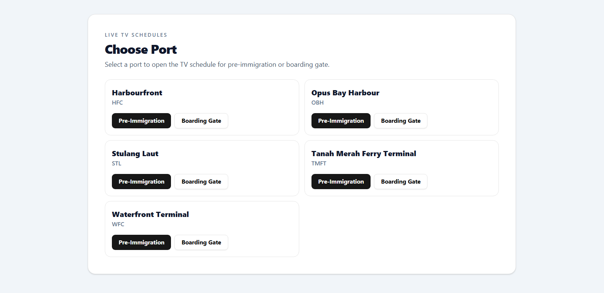
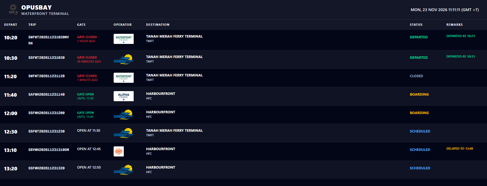
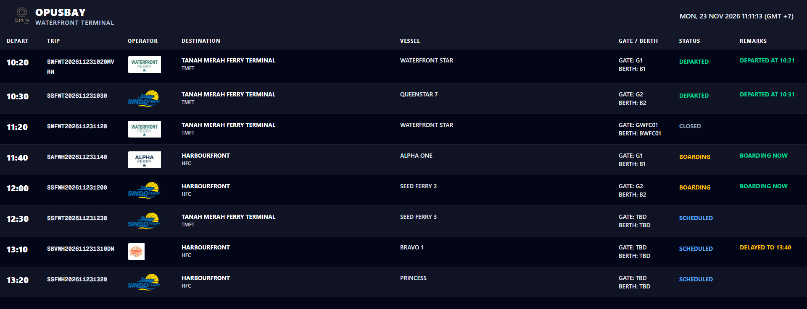
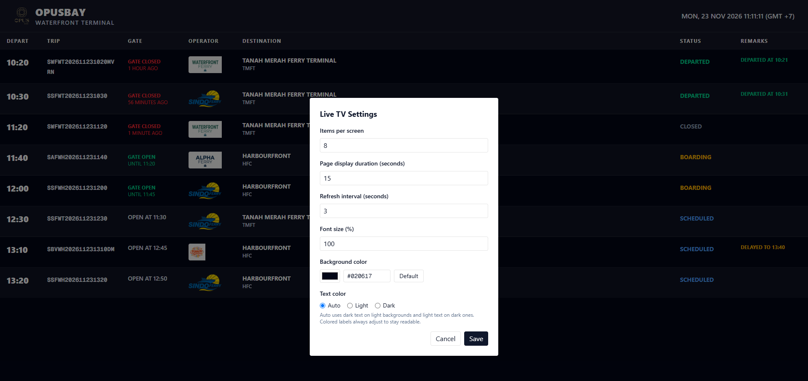
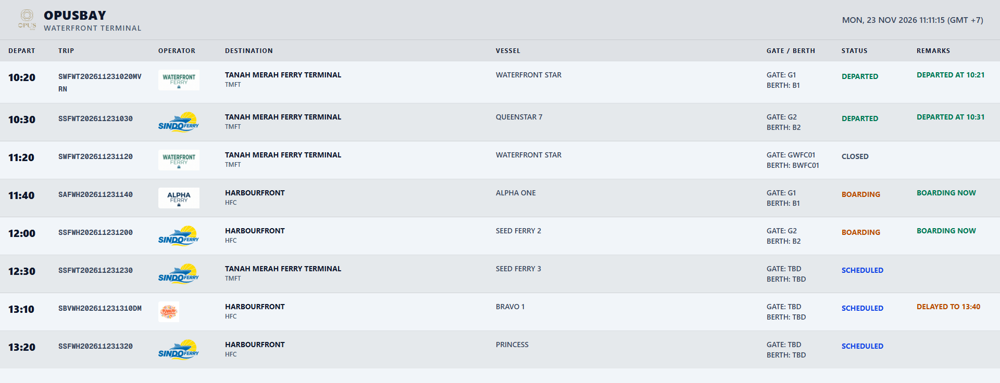

Terminal Portal menyediakan tiga **layar Live-TV publik (tanpa login)** layar penuh
yang dimaksudkan untuk dijalankan di monitor terminal:

- **Pre-Immigration Live-TV** — untuk penumpang yang akan melewati imigrasi sebelum
  naik (jam Gate dibuka / ditutup).
- **Boarding Gate Live-TV** — untuk penumpang yang akan naik (Gate / Berth,
  "boarding now", "last call").
- **Gate Live-TV** — papan khusus untuk **satu Gate Boarding**, untuk TV yang
  terpasang di Gate tersebut. Hanya menampilkan perjalanan yang sedang **Boarding
  atau Closed di Gate itu**, dengan huruf besar yang dapat diatur ukurannya.

Kedua papan tingkat Port menampilkan **kumpulan perjalanan yang sama** untuk satu
Port; perbedaannya hanya pada beberapa kolom dan label. Papan Gate hanya menampilkan
sebagian yang ditetapkan ke Gate-nya. Semua jam ditampilkan dalam **timezone lokal
Port**.

:::note[Sepenuhnya publik — tidak perlu login]
Halaman-halaman ini bersifat publik dan **tidak memerlukan login sistem** untuk
dilihat. Halaman ini dimaksudkan untuk dibuka di monitor tampilan terminal.
:::

## Membuka Papan {/* #opening-a-board */}

### Mulai dari Pemilih Port {/* #start-from-the-port-picker */}

Cara termudah adalah halaman awal **Live TV Schedules**:

`https://ts-terminal.sindoferry.com.sg/public/live-tv/`

Halaman ini menampilkan setiap Port sebagai kartu berisi **nama Port** dan **kode
Port**, masing-masing dengan dua tombol — **Pre-Immigration** dan **Boarding Gate** —
ditambah bagian **Gate TV** dengan satu tombol per Gate. Klik papan yang diinginkan
dan papan terbuka untuk Port (atau Gate) tersebut. Tidak ada yang perlu diketik, dan
tanpa login.

_Halaman Choose Port — satu kartu per Port, masing-masing membuka salah satu papan._

Gunakan halaman ini saat menyiapkan monitor baru: pilih Port sekali, lalu bookmark
papan yang terbuka.

### Menyiapkan TV Gate {/* #setting-up-a-gate-tv */}

Untuk TV yang terpasang di Gate Boarding:

1. Di TV Gate tersebut, buka halaman awal di atas.
2. Di kartu Port, pada bagian **Gate TV**, klik tombol untuk Gate tersebut (misalnya
   **Gate G1**).
3. Tekan **F11** untuk layar penuh dan bookmark halamannya (atau jadikan halaman awal
   browser).

Header papan menampilkan badge besar **GATE** sehingga jelas TV itu milik Gate mana.
Papan hanya mencantumkan perjalanan yang **Boarding** atau **Closed** di Gate itu —
dengan logo operator, tujuan, jam keberangkatan, Berth, dan sinyal langsung
(**BOARDING NOW**, **LAST CALL**, atau **GATE CLOSED**). Saat tidak ada yang Boarding,
tertulis _"NO BOARDING TRIPS AT THIS GATE RIGHT NOW."_ — keadaan diam yang normal.

Hanya Gate **aktif** yang muncul di pemilih. Jika Gate kemudian dinonaktifkan atau
dihapus, TV-nya menampilkan pesan jelas *"GATE NOT FOUND FOR THIS PORT."* (dan pulih sendiri jika
Gate diaktifkan kembali).

### Atau Tautkan Langsung ke Papan {/* #or-link-straight-to-a-board */}

Jika Anda sudah tahu id Port-nya, Anda dapat melewati pemilih dan langsung membuka
papan. **`portId`** adalah Port asal; dengan Port `2` sebagai contoh:

- **Pre-Immigration Live-TV:**
  `https://ts-terminal.sindoferry.com.sg/public/live-tv/pre-immigration/?portId=2`
- **Boarding Gate Live-TV:**
  `https://ts-terminal.sindoferry.com.sg/public/live-tv/boarding-gate/?portId=2`
- **Gate Live-TV** (juga membutuhkan id Gate, misalnya Gate `5`):
  `https://ts-terminal.sindoferry.com.sg/public/live-tv/gate/?portId=2&gateId=5`

:::caution[Pertahankan garis miring sebelum `?`]
Garis miring di `.../pre-immigration/?portId=2` itu penting. Tanpanya, pengalihan
situs menghilangkan query string, papan kehilangan `portId`-nya, dan tidak ada yang
dimuat.
:::

Untuk tampilan terbaik, buka papan di browser monitor dan tekan **F11** untuk mode
layar penuh (kiosk).

_Papan Pre-Immigration — perhatikan kolom **Gate** yang menampilkan status Gate dibuka / ditutup._

_Papan Boarding Gate — dengan kolom **Vessel** dan **Gate / Berth**._

:::tip
Papan hanya menampilkan perjalanan **hari ini** untuk Port yang dipilih, dalam
timezone Port tersebut. Perjalanan yang dibatalkan tidak pernah ditampilkan;
perjalanan yang sudah **berangkat** tetap tampil sekitar satu jam, lalu hilang.
:::

## Isi Setiap Papan {/* #what-each-board-shows */}

Papan mencantumkan perjalanan hari ini, diurutkan berdasarkan jam keberangkatan.
Untuk setiap perjalanan Anda melihat **keberangkatan** terjadwal, **kode
perjalanan**, **operator**, **tujuan**, **Vessel**, **Gate / Berth**, dan **status**
perjalanan: **SCHEDULED**, **BOARDING**, **CLOSED**, atau **DEPARTED**, ditampilkan
sebagai teks berwarna. Semua tulisan di papan memakai huruf kapital agar mudah dibaca
dari jauh.

Sinyal **Remarks** menyorot hal yang penting saat ini:

| Sinyal | Artinya |
| --- | --- |
| **BOARDING NOW** | Perjalanan dibuka untuk Boarding. |
| **LAST CALL** | Sedang Boarding dan keberangkatan sekitar 5 menit lagi atau kurang. |
| **DELAYED TO hh:mm** | Perjalanan ditunda ke jam yang baru. |
| **DEPARTED AT hh:mm** | Jam keberangkatan sebenarnya (tampil sekitar 1 jam setelah keberangkatan). |

Di papan **Pre-Immigration**, kolom **Gate** juga menampilkan status Gate imigrasi
berdasarkan jam Gate dibuka / ditutup terjadwal: **OPEN AT hh:mm** (belum dibuka),
**GATE OPEN / UNTIL hh:mm**, atau **GATE CLOSED / … AGO**.

## Pembaruan Otomatis dan Rotasi {/* #auto-refresh-and-rotation */}

- Papan **memperbarui datanya** secara otomatis (setiap beberapa detik) dan tetap
  menampilkan data terakhir yang benar jika pembaruan sempat gagal.
- Jika perjalanan lebih banyak dari yang muat di satu layar, papan **berganti
  halaman** secara otomatis, berhenti sejenak di setiap halaman sebelum pindah ke
  halaman berikutnya.
- Saat tidak ada perjalanan, tertulis _"NO DEPARTURE TRIP SCHEDULE FOUND FOR SELECTED
  PORT."_

## Mengatur Tampilan Layar {/* #configuring-the-screen-display */}

Saat halaman Live-TV terbuka, Anda dapat membuka panel pengaturan tersembunyi untuk
mengatur tata letak, kecepatan, ukuran, dan warna papan:

1. Klik di mana saja pada layar.
2. Tekan **Ctrl + Shift + S** untuk membuka panel **Live TV Settings**.

_Panel Live TV Settings — tata letak dan kecepatan, Font size, Background color, dan Text color._

Di panel tersebut Anda dapat mengatur:

| Pengaturan | Yang dikendalikan |
| --- | --- |
| **Items per screen** | Berapa perjalanan (baris) yang tampil di satu halaman sebelum berganti halaman. |
| **Page display duration** | Berapa lama (dalam detik) sebuah halaman tampil sebelum berganti ke halaman berikutnya. |
| **Refresh interval** | Seberapa sering (dalam detik) papan mengambil data terbaru. |
| **Font size (%)** | Mengubah skala seluruh papan: teks, baris, dan logo (100 = normal). Default-nya 100 di papan Pre-Immigration dan Boarding Gate, serta 150 di papan Gate. Jika baris tidak lagi muat di layar, kurangi **Items per screen**. |
| **Background color** | Warna latar papan. Pilih warna, atau ketik kode hex seperti `#F1F5F9`. **Default** mengembalikan warna biru tua gelap semula. |
| **Text color** | **Auto** memakai teks gelap di latar terang dan teks terang di latar gelap. **Light** atau **Dark** memaksa salah satunya. Status, Remarks, dan label berwarna lainnya selalu menyesuaikan agar tetap terbaca di latar yang dipilih. |

Klik **Save** untuk menerapkan. Pengaturan ini disimpan **per perangkat** (di browser
tersebut), sehingga setiap monitor dapat diatur sendiri dan tetap menyimpan
pengaturannya setelah dimuat ulang. Papan Pre-Immigration dan Boarding Gate memakai
pengaturan yang sama di satu perangkat; papan Gate menyimpan pengaturannya sendiri.

_Papan Boarding Gate dengan Background color `#F1F5F9` — **Auto** beralih ke teks gelap dan warna yang lebih pekat._

:::tip[Memilih warna latar]
Warna pastel terang dan warna gelap paling mudah dibaca dan tetap menampilkan warna
status serta Remarks. Pada warna sedang yang kuat, seperti biru cerah, label yang
warnanya tidak terbaca di atasnya beralih ke warna teks biasa — tetap terbaca, tetapi
tanpa warnanya.
:::

:::tip[Pengaturan per perangkat]
Karena pengaturan disimpan di perangkat, atur sekali di setiap monitor terminal. Buka
lagi panelnya dengan **Ctrl + Shift + S** kapan saja untuk menyesuaikan.
:::
